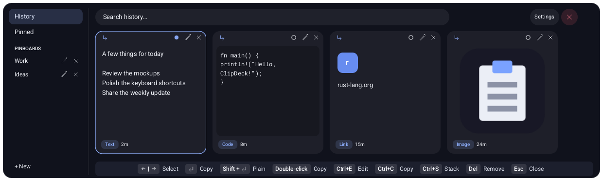

# ClipDeck

A native **Linux clipboard manager**, written in Rust. Search clipboard history,
organize clips into pinboards, pin favorites, and copy from a compact overlay.



## Install

For Ubuntu 24.04 or newer on x86_64 (`amd64`) or ARM64 (`arm64`), download the
matching Debian package from
[GitHub Releases](https://github.com/mhosseinab/clipdeck/releases/latest).

```bash
sudo apt install ./clipdeck_2.1.0-1_$(dpkg --print-architecture).deb
clipdeck
```

On first launch, choose whether to encrypt saved history. Later starts keep the
daemon hidden; use the tray menu or `clipdeck open` to show it.
A prefix-layout tarball is also available; it requires glibc 2.39 or newer and
the runtime libraries listed in the Debian package dependencies.

Before upgrading, quit ClipDeck and back up your complete profile. This version
starts fresh from legacy JSON history; it does not migrate those records.
Existing SQLite history is preserved.

## Repository map

| Path | Purpose |
| --- | --- |
| `apps/linux/crates/app/` | Native UI, clipboard worker, tray and desktop integration |
| `apps/linux/crates/core/` | Store, classification, settings, sync and fixture tests |
| `spec/` | Behavior contract, fixtures, schemas and reference oracle |
| `scripts/` | Verification and local candidate packaging |
| `docs/` | Contributor and agent workflow guide |
| `.agents/`, `.codex/`, `AGENTS.md` | Repository-scoped agent skills and rules |

## Build and run

Requires Rust 1.89 or newer (use current stable), a C build toolchain, `make`,
Perl, and `pkg-config` / `libdbus-1-dev` on Ubuntu. SQLCipher and OpenSSL are
built through the Rust dependency graph. A graphical Linux session
is required to run the app. GNOME users need a tray extension for tray visibility;
the CLI works without a tray.

```bash
bash scripts/check.sh linux
./apps/linux/target/release/clipdeck run
```

## Packaging

Requires `cargo-deb` 3.8.0, `dpkg-deb`, `desktop-file-validate`, `appstreamcli`, `tar` and
`sha256sum` in addition to the build tools. On Ubuntu, the desktop validator is
provided by `desktop-file-utils`, and `appstreamcli` by `appstream`.
Install tooling separately if missing.

```bash
bash scripts/package.sh
# -> dist/candidate/*.deb, *.tar.gz, SHA256SUMS
```

This command runs checks, builds the binary, validates both package payloads
and writes checksums. It does not install, tag, upload or publish anything.
A package built on a newer distro may not run on older Ubuntu versions.
Build on the oldest supported distro when preparing portable packages.
The tarball contains `usr/bin/clipdeck`, desktop/icon resources and licenses;
it is an extracted prefix layout, not an AppImage or self-contained runtime.

## Using ClipDeck

- X11 global shortcut: `Ctrl+Shift+V` (recorder in Settings) — show/hide the overlay
- GNOME Wayland: use `clipdeck toggle` or a custom desktop shortcut (see below)
- Tray menu: open, settings, pause watching, recent items, quit
- Runs at login (autostart entry, toggle in Settings)
- CLI: `clipdeck toggle|open|settings|quit|export|import`
- Version: shown in Settings and printed by `clipdeck --version`

Use each card's pin control to pin or unpin it. The bottom hint bar groups
shortcuts in brighter keycaps.

Linux overlay controls: **Enter** or **double-click a card** copies it to the
clipboard and closes the overlay; **Shift+Enter** copies plain text.
Paste into the destination app yourself. ClipDeck does not simulate keyboard or
mouse input. **Escape** or **Back** returns from Settings to the clipboard view.
In the clipboard view, **Escape** and the top-right **×** close the overlay while
the daemon stays running. The **×** beside a pinboard deletes that board and
keeps its clips in History.

Use the **pencil beside a board** to rename it, then press Enter or Save. Use
the **↪** arrow on a clip card to choose its board. Choose **No board (History)**
to remove its board membership. The picker scrolls when there are more boards
than fit on screen; moving preserves the clip's pin and paste-stack state.

You can also **drag a card onto a sidebar board**. A floating card with a shadow
follows the pointer, the original dims, and the target board highlights. Release
outside a board to cancel. The main window has transparent rounded corners.

A successful drop briefly pulses the destination board and shows **Moved to…**.
Deletion asks for confirmation. Removing a clip from a board keeps it in History
unless you check **Also delete from History**; deleting directly from History
removes the clip after confirmation. Deleting a board keeps all its clips.

The window requests **always on top**. On GNOME Wayland, ClipDeck uses its XWayland
window mode when available so the desktop can honor that request. Set
`CLIPDECK_FORCE_X11=0` to use native Wayland instead; native Wayland does not
support this window-level request in the current window library.

### GNOME Wayland shortcut

In ClipDeck **Settings → Global shortcut**, use **Copy Command**, then
**Open Keyboard Settings**. The copied command uses the running executable's
absolute path, so it also works when running from this checkout. ClipDeck hides
its overlay when opening GNOME Settings so the always-on-top window stays out
of the way. Follow the panel's steps to add the custom shortcut.

The built-in shortcut uses X11 grabs and does not provide a global shortcut for
native Wayland apps. Use a GNOME custom shortcut for native Wayland apps.

In GNOME **Settings → Keyboard → View and Customize Shortcuts → Custom Shortcuts**,
add a shortcut named **ClipDeck**, with command `clipdeck toggle`, and choose your
preferred keys (for example, Ctrl+Shift+V). If ClipDeck is running from this
checkout rather than installed, use the executable's absolute path followed by
`toggle`. The daemon must already be running. This command uses ClipDeck's
control socket; it does not inject keyboard or mouse input. A key combination
already used by GNOME or an application may need to be reassigned.

### Export history

JSON export is available from the CLI:

```bash
clipdeck quit
clipdeck export ~/clipdeck-export.json
clipdeck
```

The destination is optional; the default is `clipdeck-export.json` in the current
working directory. Exports are **plaintext**, even when saved history is
encrypted. They contain full clip records and boards, but not image-file bytes,
settings or encryption keys. For a full backup, quit ClipDeck and copy the entire
profile; an encrypted backup also needs its desktop-keyring key.

## Development

```bash
bash scripts/check.sh spec        # fixture oracle
bash scripts/check.sh linux-core  # oracle + Rust core fixtures
bash scripts/check.sh linux       # oracle + workspace tests + release build
```

Stop the daemon before using CLI `import` or `export`; both require exclusive
profile ownership. Back up the full profile before installing a candidate.
CLI `export` contains records, not image-file bytes or settings.

The default profile is `$XDG_DATA_HOME/clipdeck`, falling back to
`~/.local/share/clipdeck` when `XDG_DATA_HOME` is unset or not absolute.
Set `CLIPDECK_USER_DATA` to
use a separate profile, and pass the same value to its daemon and CLI commands.
Each profile has a private `.ipc/control.sock`; multiple profiles have independent
control endpoints. Profiles and control directories use owner-only permissions.
Keep profile paths short enough for Linux's Unix-domain socket path limit.

ClipDeck stores history in `clipdeck.sqlite3`. The overlay loads small pages of card
summaries, fetching full clip contents when needed. Database and thumbnail
caches have separate budgets. Legacy `clipdeck-store.json` history is discarded
instead of migrated. Existing SQLite history and images are preserved when
adopting a profile layout or changing encryption mode. For an existing storage
directory, a missing policy or active database is reported as an error instead
of silently starting fresh.

On first launch, choose encrypted history or continue without encryption before
clipboard watching starts. Encryption uses SQLCipher with a key stored in the
OS keyring. Losing that key makes encrypted history unreadable. Settings can
enable or disable encryption after a restart while preserving the current
database and images. A locked or unavailable keyring never causes plaintext
fallback. Images stay in external files, encrypted when encrypted history is
enabled.
Encrypted history requires a Secret Service keyring and `secret-tool`
(`libsecret-tools` on Ubuntu). Plaintext history works without them.

For AI-assisted development, see [the agent setup guide](docs/agentic-development.md)
for project rules, reusable skills, optional agents, and scoped check commands.

## Current limitations

GNOME Wayland needs a system custom shortcut. Source-app identity is unknown
for native Wayland captures, so app-based exclusion/confidential filters cannot
protect those captures. Transient clipboard markers and screen-share exclusion
are unsupported. Unavailable options are omitted from Settings. Do not rely on those
features for privacy; pause watching or quit ClipDeck when handling sensitive
content.

## Format compatibility

Native persistence uses SQLite. JSON export/import and JSONL folder sync remain
available; their formats are described in `spec/schema/`. Quit ClipDeck before
copying or restoring a profile, and include `clipdeck-security.json` and its
active storage directory with the database, any SQLite sidecars and images.
Encrypted profiles also require their OS
keyring key associated with the canonical profile path. Moving a profile does
not automatically move that keyring association. JSON exports and the system
clipboard are plaintext. JSONL folder
sync is disabled for encrypted profiles; encryption does not protect old
exports or files. CLI `export` contains full clip records but does not include
image-file bytes, settings or encryption keys.

## License

MIT
